<a href="README_en.md">🇺🇸 English</a> | <b>🇧🇷 Português</b>

<h1 align="center">Olá 👋, eu sou Luciano Murilo T. Besse</h1>
<h3 align="center">Tech Lead | Engenheiro de Software Backend | PHP, Symfony, APIs e Integrações Financeiras | Sistemas Distribuídos e IA</h3>

  
  

---

### 💼 Sobre mim
Tech Lead e Engenheiro Backend com mais de 14 anos de experiência, de sistemas ERP e apps mobile a plataformas SaaS e produtos de saúde digital.

- 🚀 Criador do **ChatManager**, SaaS de automação multicanal com clientes pagantes desde 2022 ([chatmanager.com.br](https://chatmanager.com.br))
- ⚡ Reescrevi a automação de WhatsApp em Go (whatsmeow), reduzindo o consumo de memória de ~500 MB para ~20 MB por instância
- 💳 Automatizei fluxos financeiros de ponta a ponta (boletos, pagamentos via TED, comissões, conciliação bancária) com webhooks idempotentes e filas
- 👥 Liderei 2 squads ágeis (9 pessoas) como Tech Lead
- 🌱 Foco em performance de backend, microsserviços e integrações de IA (LLMs, RAG, Tool Calling)
- 💬 Pergunte-me sobre **PHP (Symfony/Laravel)**, **Go**, **Arquitetura de Sistemas**, **IA** e **Liderança Técnica**

---

### 🛠️ Linguagens e Ferramentas

💻 **Desenvolvimento Backend**

🗄️ **Bancos de Dados e Mensageria**

☁️ **DevOps, Cloud e Infraestrutura**

📱 **Desenvolvimento Mobile**

🔧 **Ferramentas de Desenvolvimento**

